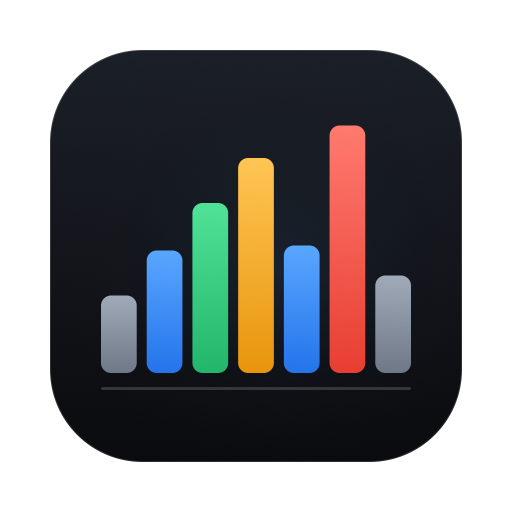
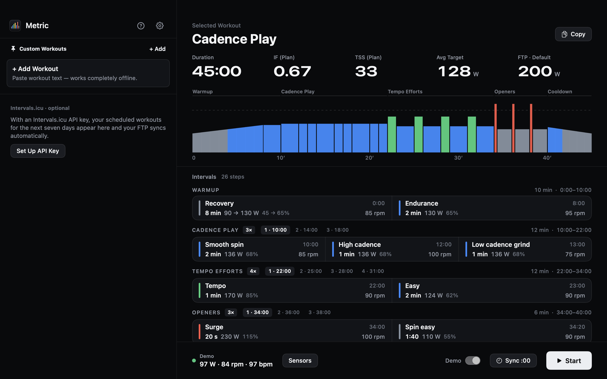
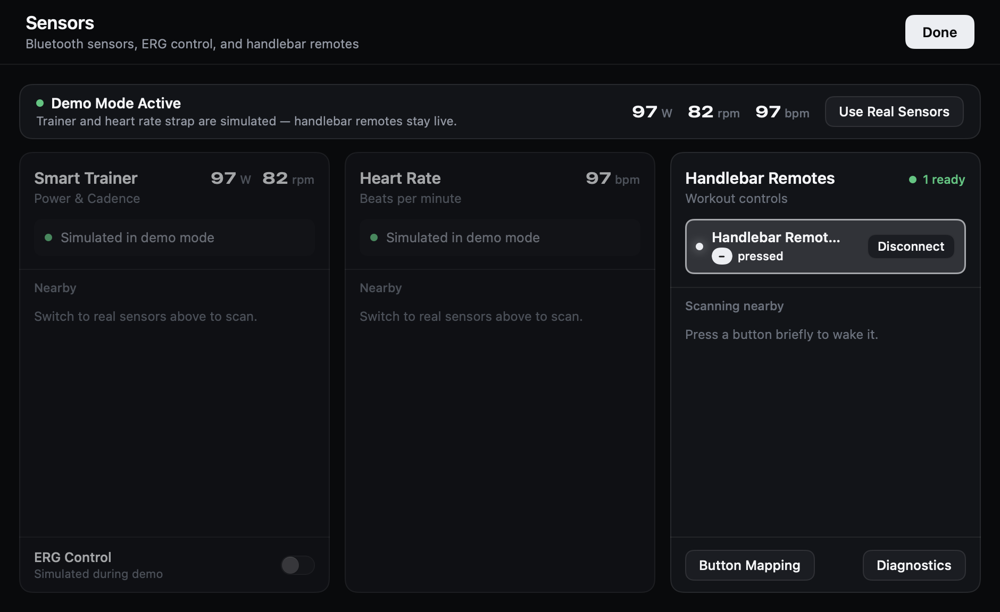
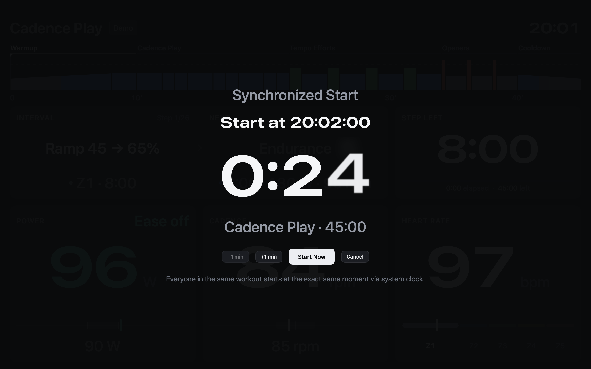
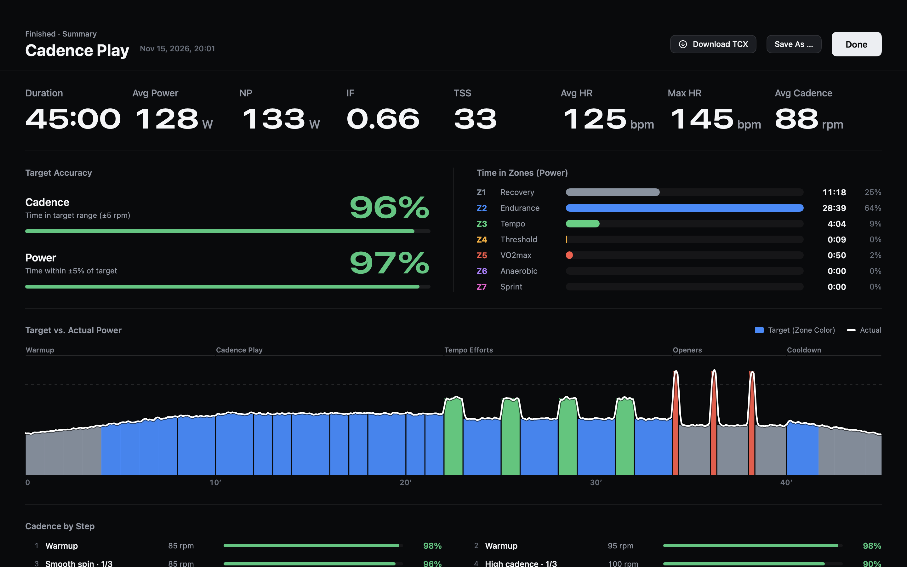

<div align="center">



# Metric Cycling

**Metric** is a native macOS cockpit for structured indoor cycling.<br>
Calm typography, high contrast, and effortless sensor control — built for monitors and projectors.

<br>

<a href="https://github.com/Lassegra/metric/releases/latest/download/Metric.dmg">
  
</a>

<p>
  <a href="https://github.com/Lassegra/metric/releases/tag/v1.3.0"><strong>Version 1.3.0</strong></a>
  &nbsp;·&nbsp;
  macOS 14+
  &nbsp;·&nbsp;
  Apple Silicon & Intel
  &nbsp;·&nbsp;
  <a href="https://github.com/Lassegra/metric/releases">ZIP & Checksums</a>
</p>

<br>


</div>

<br>

## Built Around Your Setup

Ride alongside your bike computer as a distraction-free display companion — or let Metric control your smart trainer directly with **ERG Control** (`FTMS`) and automatic **TCX Export** to your `Downloads` folder.

<table>
  <tr>
    <td width="50%" valign="top">
      
      <p><strong>Plan & Preview</strong><br>
      Inspect grouped workout phases, collapsed repeat rounds, interactive profile charts, IF/TSS estimates, and one-click <strong>Copy</strong> for training partners.</p>
    </td>
    <td width="50%" valign="top">
      
      <p><strong>Sensors, ERG & Remotes</strong><br>
      Pair smart trainers (<code>FTMS</code> / <code>Cycling Power</code>), heart rate straps, and compatible Bluetooth handlebar remotes with live button feedback and per-controller <strong>Button Mapping</strong> right inside Sensors.</p>
    </td>
  </tr>
  <tr>
    <td width="50%" valign="top">
      
      <p><strong>Train Together with Sync :00</strong><br>
      Share the workout text with <strong>Copy</strong>, paste it on both Macs, and start at the exact same second using system clock time — no accounts needed.</p>
    </td>
    <td width="50%" valign="top">
      
      <p><strong>Honest Post-Ride Summary</strong><br>
      Review Duration, Avg Power, NP, IF, TSS, target accuracy, time in zones, and export clean <code>Metric_*.tcx</code> files to <code>Downloads</code>.</p>
    </td>
  </tr>
</table>

<br>

## Highlights

- **Focused Instrument Cockpit** — Matte high-contrast 3-column telemetry (`Power`, `Cadence`, `Heart Rate`) with `SF Pro Expanded` typography, calibrated target gauges, calm steady-state readouts with crisp out-of-target action cues, and an always-visible wall clock (even while paused).
- **Offline Custom Workouts (`⌘ N`)** — Write workouts in compact text syntax with a live profile chart, IF/TSS metrics, parser notices, and interval breakdown, pick from 4 built-in templates, or import `.txt` files and clipboard text. Everything stays local on your Mac.
- **Live Workout Intensity (`50%`–`150%`)** — Dial target watts up or down in `±5%` steps mid-ride from the cockpit bar, keyboard (`↑` / `↓`, `0` to reset), or a mapped handlebar remote button without interrupting ERG control.
- **Optional Intervals.icu Sync** — Enter a personal API key in **Settings (`⌘ ,`)** to load scheduled workouts (today + 6 days) and your Ride FTP. Keys stay exclusively in the **macOS Keychain** with strictly read-only HTTPS GET calls.
- **Automatic Update Checks** — Optionally checks GitHub Releases on launch (or manually via **Metric → Check for Updates …**) with release highlights and a direct download link for `Metric.dmg`.
- **Keep Your Bike Computer Connected** — Many trainers and straps allow only one or two concurrent Bluetooth connections. Pair your bike computer over **ANT+** whenever available so Bluetooth stays free for your Mac.

<br>

## Installing

1. Click **[Download Metric](https://github.com/Lassegra/metric/releases/latest/download/Metric.dmg)**, open **`Metric.dmg`**, and drag **`Metric`** into **`Applications`** *(or download `Metric.zip` under [Releases](https://github.com/Lassegra/metric/releases))*.
2. **First launch:** Because Metric is distributed directly outside the Mac App Store (ad-hoc signed without a paid Apple Developer certificate), open **System Settings → Privacy & Security** → scroll down → click **Open Anyway** next to *"Metric" was blocked*.
   ```bash
   xattr -dr com.apple.quarantine "/Applications/Metric.app"
   ```
3. Click **Allow** when macOS asks for **Bluetooth** permission.

<br>

<details>
<summary><strong>Keyboard Shortcuts & Workout Syntax</strong></summary>

<br>

| Shortcut | Action | | Shortcut | Action |
|---|---|---|---|---|
| `Space` | Pause / Resume | | `⌘ ↩` | Start workout |
| `←` / `→` | Previous / Next step | | `F` or `⌃⌘F` | Fullscreen |
| `↑` / `↓` | Intensity `+5%` / `−5%` | | `M` | Sound on / off |
| `0` | Reset intensity (`100%`) | | `⌘ B` | Sensors |
| `+` / `−` | Jump 5 s forward / back | | `⌘ ,` | Settings |
| `Esc` | Pause | | `?` | Shortcuts overview |
| `⌘ .` | End workout | | | |

<br>

```text
Warmup
- 10m ramp 50-75% 85rpm

Sweetspot
3x
- 10m 90% 88rpm
- 4m 55% 90rpm

Cooldown
- 6m ramp 60-45% 85rpm
```

</details>

---

<div align="center">

**Privacy:** No accounts, no tracking, no analytics.<br>
[Release Notes](CHANGELOG.md) &nbsp;·&nbsp; [All Releases](https://github.com/Lassegra/metric/releases) &nbsp;·&nbsp; [License](LICENSE)

<sub>© 2026 Lasse Grabenhenrich. All rights reserved. Official releases may be downloaded for personal use; modification or redistribution is not permitted.</sub>

</div>
