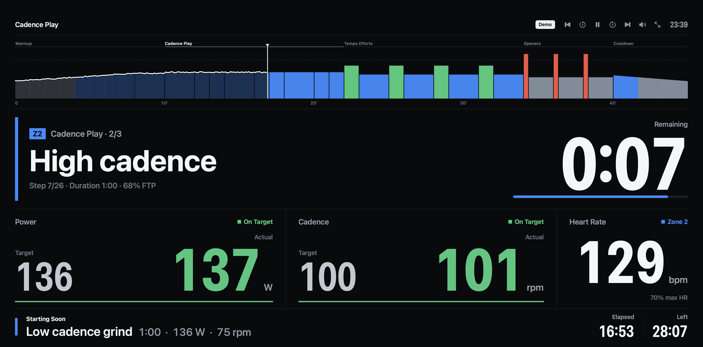
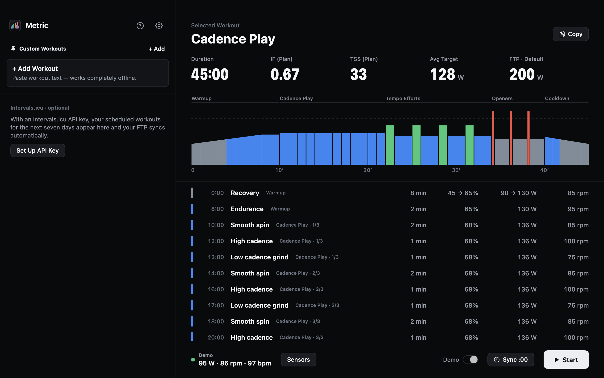
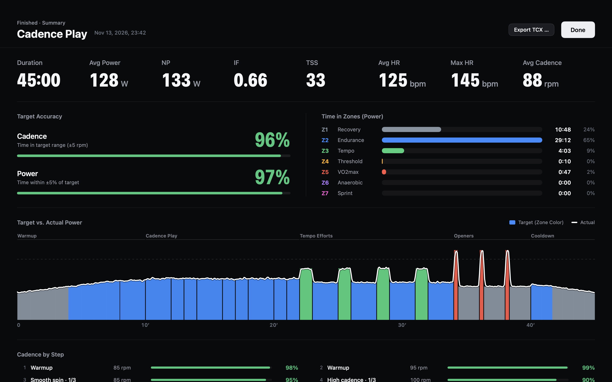

# Metric Cycling

**Metric Cycling** is the official download repository for **Metric**, a native macOS app for structured indoor cycling workouts: smart trainer telemetry (FTMS & Cycling Power), heart rate, optional FTMS ERG control, compatible Bluetooth handlebar remotes, synchronized group starts (`Sync :00`), TCX export, and optional Intervals.icu integration — designed with high contrast and clean typography for external monitors and projectors.

> **Project Name vs. App Name:** On GitHub, this project is titled **Metric Cycling** so cyclists can find it easily. After downloading and unzipping `Metric.zip`, the macOS application itself is consistently named **Metric** (`Metric.app`).

**Default Role:** By default, your bike computer stays in charge — **Metric is read-only**, does not control the trainer, and stores no ride files. Optionally, you can enable **ERG control** (FTMS) and automatic **TCX export** to your `Downloads` folder in Settings.

---

## Download

- **[Download Metric for macOS (`Metric.zip`)](https://github.com/Lassegra/metric/releases/latest/download/Metric.zip)** *(macOS 14+, Universal Binary for Apple Silicon & Intel)*
- **[All Releases, DMG Installer & SHA-256 Checksums](https://github.com/Lassegra/metric/releases)**

---

| Home & Workout Preview | Sensors & Handlebar Remotes | Post-Ride Summary |
|---|---|---|
|  |  |  |

---

## Installing

1. Download **`Metric.zip`** from the link above, unzip it, and move **`Metric.app`** into **`/Applications`** *(or download `Metric.dmg` from Releases and drag `Metric.app` onto `Applications`)*.
2. **First launch on macOS:** Because Metric is distributed directly without a paid Apple Developer certificate (ad-hoc signed, not notarized), macOS requires one confirmation step on first launch (and after updates):
   - Open **System Settings → Privacy & Security** → scroll down → next to *"Metric" was blocked*, click **Open Anyway**.
   - Alternatively in Terminal: `xattr -dr com.apple.quarantine "/Applications/Metric.app"`
3. Click **Allow** when macOS prompts for **Bluetooth** permission.

---

## Features & Quick Setup

- **Sensors (`⌘B`):** Pair your smart trainer (`0x1826` FTMS / `0x1818` Cycling Power) and heart rate strap (`0x180D` Heart Rate). Paired sensors reconnect automatically.
  > **Tip — Bike Computer via ANT+:** Many trainers and straps support only one or two concurrent Bluetooth connections. Pair your bike computer over **ANT+** whenever possible so Bluetooth stays free for your Mac.
- **Optional ERG Control (FTMS `0x2AD9`):** Toggle **ERG Control** directly in **Sensors** or **Settings → During Ride** if you ride without a head unit. Leave it off when running a workout on your bike computer simultaneously.
- **Handlebar Remotes:** Pair compatible Bluetooth handlebar remotes and customize button actions in **Settings**.
- **Offline Custom Workouts (`⌘N`):** Create and edit workouts with compact text syntax, start from 4 built-in templates, import `.txt` files or clipboard text, duplicate, and pin workouts to the top.
- **Synchronized Group Starts (`Sync :00`):** Copy workout text with one click (`Copy`) to share with training partners and start simultaneously at the next whole minute (`−1 min`, `+1 min`, `Start Now`) using system clock time — no accounts required.
- **Optional Intervals.icu Sync:** Add a personal API key in **Settings (`⌘,`)** to load scheduled workouts (today + 6 days) and your cycling FTP. Your key stays in the macOS Keychain (`kSecAttrAccessibleWhenUnlockedThisDeviceOnly`) and sends strictly read-only HTTPS GET calls to `intervals.icu`.
- **Summary & TCX Export:** Review Duration, Avg Power, NP, IF, TSS, Avg/Max HR, Avg Cadence, target accuracy, and time in zones after each ride. Export manually (`Export TCX …`) or enable automatic saving (`Metric_*.tcx`) to `Downloads`.

## Keyboard Shortcuts

| Shortcut | Action |
|---|---|
| `Space` | Pause / Resume |
| `←` / `→` | Previous / Next step |
| `+` / `−` | Jump 5 s forward / back |
| `Esc` | Pause |
| `⌘ .` | End workout |
| `⌘ ↩` | Start workout |
| `F` or `⌃⌘F` | Fullscreen |
| `M` | Sound on / off |
| `⌘ B` | Sensors |
| `⌘ ,` | Settings |
| `?` | Keyboard shortcuts overview |

---

## Privacy & License

- **Privacy:** No accounts, no tracking, no analytics, and no third-party telemetry.
- **License:** Copyright © 2026 Lasse Grabenhenrich. **All rights reserved.** See [LICENSE](LICENSE). Official release binaries may be downloaded and used for personal, non-commercial indoor cycling; modification or redistribution is not permitted.
